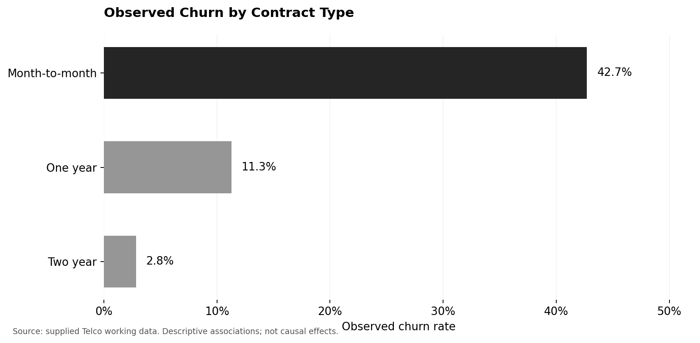
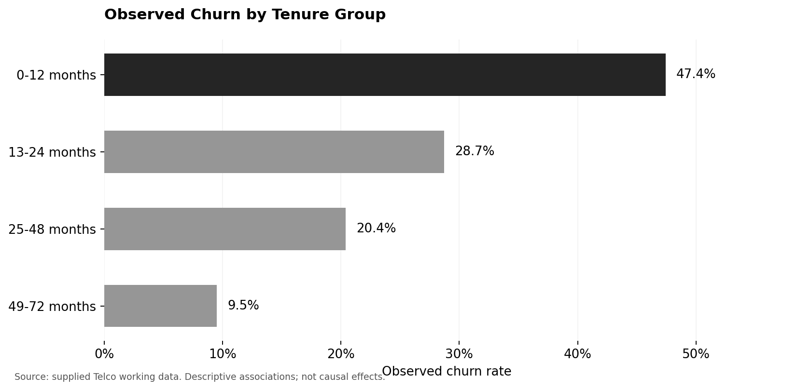

# Exploratory Findings and Initial Churn Hypotheses

## Purpose and scope

This report summarizes the main patterns found during the second week of exploratory analysis. The goal was to identify customer groups with higher churn and to explore service experiences that might be relevant to retention.

The Telco Customer Churn dataset provides the churn label. The Customer Support Tickets dataset provides a separate view of service experience, including issue type, status, priority, channel, satisfaction, and timestamps. Because the datasets have no shared customer ID and the support data has no churn label, the support analysis cannot directly establish a relationship with churn.

## Main Telco patterns

Of the 7,043 customers, 1,869 churned, giving an overall rate of about 26.5%.

Month-to-month customers have substantially higher churn than customers on one- or two-year contracts. They can leave more easily, which makes contract flexibility a useful hypothesis to examine.

Customers with short tenure, especially those in the first 12 months, have higher observed churn. This suggests that the early customer lifecycle is an important stage to investigate. Possible explanations include weak usage habits or an unclear sense of product value, although those explanations are not directly measured here.

Electronic check users have higher churn than automatic payment users. Payment method may reflect different customer habits or levels of commitment; it should not automatically be interpreted as proof of price sensitivity.

Customers without TechSupport have higher churn than those with support. The same general pattern appears for OnlineSecurity and OnlineBackup. Customers using several services may be more attached to the provider, while customers using only basic services may find it easier to switch.

MonthlyCharges is also worth investigating. Customers paying more may have higher expectations about value and service quality. A useful follow-up is to examine high charges together with support availability and service adoption.

## Support ticket findings

The support analysis looked at ticket type, status, priority, channel, and average satisfaction. Technical issues, billing inquiries, refund requests, and cancellation requests are useful categories for understanding customer experience. Refund and cancellation requests could be warning signals, but they are not observed churn outcomes in this dataset.

Average satisfaction was compared across issue types, priorities, and channels. Low scores may identify experiences worth improving. However, satisfaction is recorded only for closed tickets, so those averages do not describe every customer or every open issue.

There are 1,365 records where the resolution timestamp is earlier than the first response timestamp. These are flagged as invalid for interval analysis. A label of Valid in the original code means no reversed timestamp was detected; it does not guarantee that both timestamps are present.

If comparable support records could later be linked to real customer churn labels, these service experience hypotheses could be tested directly.

## Initial customer profiles

| Profile | Typical characteristics | Interpretation |
| --- | --- | --- |
| Higher observed risk | Month-to-month contract, short tenure, no technical support, limited security or backup adoption, electronic check payment, possibly high charges | Several observed risk signals occur together; this is a descriptive profile, not a validated customer risk score. |
| More stable | One- or two-year contract, longer tenure, automatic payment, broader service adoption | These characteristics are associated with lower churn in the Telco data. |
| Possible value concerns | Higher charges with limited add-on use | A hypothesis about perceived value; price sensitivity is not measured directly. |
| Possible service concerns | Technical, billing, refund, or cancellation tickets; low recorded satisfaction; unresolved issues | A separate support profile whose relationship with churn remains untested. |

## Patterns to carry into modeling

The main observed patterns involve short contracts, short tenure, lack of technical support, low adoption of security or backup services, and electronic check payments. Support issues are potential risk signals for future work with linked data.

These patterns describe associations. They do not show that changing a contract, payment method, or service would necessarily prevent churn.

## Initial hypotheses and checks

| Hypothesis | Proposed check |
| --- | --- |
| Month-to-month customers have higher churn than customers on annual contracts. | Compare observed churn rates by Contract. |
| Shorter-tenure customers have higher churn. | Compare 0-12, 13-24, 25-48, and 49-72 month groups. |
| Customers without TechSupport have higher churn. | Compare Yes, No, and No internet service separately. |
| Electronic check users have higher churn than automatic payment users. | Compare the four PaymentMethod categories. |
| Customers without OnlineSecurity or OnlineBackup have higher churn. | Compare service categories for each variable. |
| High charges are particularly relevant when support or add-on adoption is low. | Cross-tabulate charge groups with support, security, and backup. |
| Poor support experience is associated with later churn. | Requires linked ticket and churn data; cannot be tested with the supplied separate datasets. |

These questions guide later analysis. The exploratory comparisons alone are not formal hypothesis tests.
