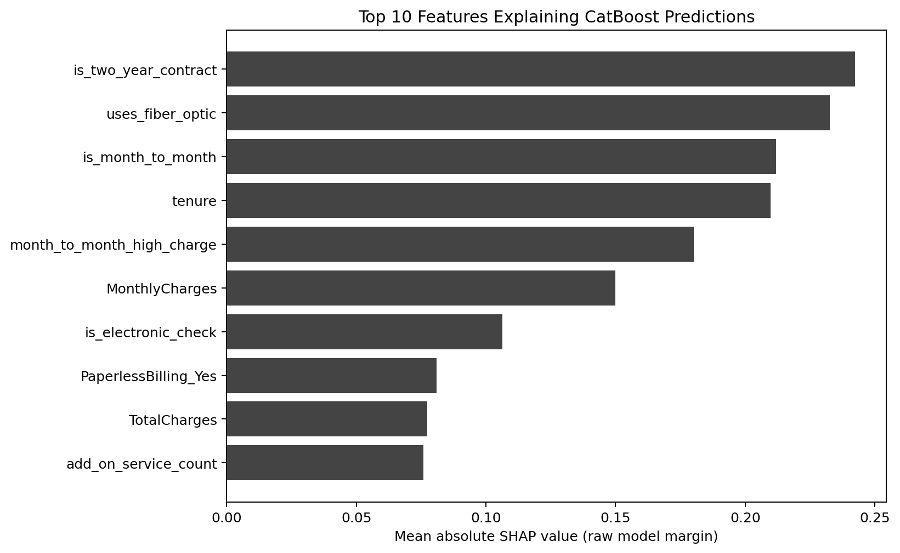

# Week 7 Model Interpretation and Customer Risk Scorecard

## Purpose

This stage explains the churn model and turns its predictions into a customer risk scorecard. The focus moves from improving model scores to understanding why the model assigns a higher score to a particular customer.

The work has three parts: use SHAP to summarize important features across customers, use LIME for local explanations of selected high-risk customers, and group customers into low, medium, and high risk using the model's predicted churn probability.

## Earlier modeling work

Week 5 compared Logistic Regression and Decision Tree models under several imbalance settings: no resampling, balanced class weights, random oversampling, SMOTE, and ADASYN. Week 6 added XGBoost, LightGBM, and CatBoost with Optuna tuning and a simple average of model probabilities.

The original Week 7 report gives the following Week 6 validation results:

| Model | Validation ROC-AUC | Classification threshold |
| --- | ---: | ---: |
| XGBoost | 0.7921 | 0.62 |
| LightGBM | 0.7951 | 0.55 |
| CatBoost | 0.7999 | 0.64 |
| Probability average | 0.7989 | 0.53 |

The probability-average AUC of 0.7989 is provided in the Week 7 report; it was not included in the earlier Week 6 performance table. It is retained here with that source distinction.

CatBoost is the selected single model in the original results and is the subject of this interpretation stage. Its saved bundle, now included with the project, contains the model, its 44 feature names, and a classification threshold of approximately 0.64. The saved model has 212 trees.

## Interpretation methods

### Global SHAP analysis

SHAP describes how features contribute to a model prediction relative to its baseline output. Mean absolute SHAP values are used to rank features across the customer sample. A larger value means that a feature contributes more to predictions on average, regardless of direction.

CatBoost's native SHAP values in this analysis are in the raw model margin space. They are not percentage-point changes in churn probability. A mean absolute importance table also does not show whether a feature increases or decreases risk; signed values and individual feature values are needed for that interpretation.

### Local LIME analysis

LIME fits a local approximation around an individual observation. It helps describe which feature conditions support or oppose that customer's predicted churn class. Its local weights depend on the sampled neighborhood and are not causal effects.

The original notebook also creates local SHAP explanations in a table named lime_like_explanations. Those rows are SHAP explanations, not LIME. The separate LimeTabularExplainer section is the actual LIME analysis. The final code and output filenames distinguish the two.

## Risk level rules

| Level | Probability range in the supplied model | Suggested use |
| --- | --- | --- |
| Low Risk | 0.00 <= p < 0.35 | Routine service and relationship maintenance. |
| Medium Risk | 0.35 <= p < 0.64 | Light follow-up, feedback requests, and service reminders. |
| High Risk | 0.64 <= p <= 1.00 | Prioritize review for a possible retention action. |

The high-risk boundary follows the saved model's validation-selected classification threshold. The 0.35 low-risk boundary is a project rule. In a newly trained run, the high-risk boundary follows that run's CatBoost threshold and can differ from 0.64. If that new threshold is at or below 0.35, the final code uses half that threshold as the low-risk boundary so the bands remain distinct. This fallback does not change the supplied scorecard or the supplied model's original boundaries.

These probabilities come from a model fitted with class weighting and were not separately calibrated. They should be treated as model risk scores rather than verified frequencies for a future customer population.

## Reported top 10 global features

| Rank | Feature | Mean absolute SHAP |
| --- | --- | ---: |
| 1 | is_month_to_month | 0.2159 |
| 2 | uses_fiber_optic | 0.2079 |
| 3 | is_two_year_contract | 0.1635 |
| 4 | MonthlyCharges | 0.1004 |
| 5 | month_to_month_high_charge | 0.0899 |
| 6 | tenure | 0.0821 |
| 7 | PaperlessBilling_Yes | 0.0768 |
| 8 | high_charge_no_support | 0.0385 |
| 9 | is_electronic_check | 0.0279 |
| 10 | high_risk_segment | 0.0278 |

These results emphasize contracts, internet service, charges, tenure, payment, and combined risk profiles. Month-to-month and two-year contract indicators are both important because contract structure helps the model distinguish customer groups. Fiber optic use may capture differences in service mix, charges, or customer expectations; the SHAP ranking alone does not establish an explanation for those differences.

The charge and support combinations also matter to the fitted model. Together with the earlier EDA, they suggest areas to investigate such as perceived value, support needs, and service adoption. Those remain business hypotheses rather than measured causes of churn.

The figure below is newly computed from the supplied PKL. Its ranking differs from the original table above. The supplied model also gives different probabilities from the separately supplied scorecard; both versions are retained, and the exact origin of the difference is not established.

## Reported local LIME example

The original report presents customer_index 2444, with predicted churn probability 0.7543. Its reported local explanation is:

| Feature | Local weight | Direction in the local explanation |
| --- | ---: | --- |
| MonthlyCharges | 0.0109 | Increases the churn-class prediction. |
| PaperlessBilling_Yes | 0.0097 | Increases the churn-class prediction. |
| TotalCharges | -0.0061 | Decreases the churn-class prediction. |
| monthly_charge_group_Medium | -0.0043 | Decreases the churn-class prediction. |
| monthly_charge_group_Very High | 0.0033 | Increases the churn-class prediction. |

The source report abbreviates the LIME rules to feature names. Newly generated LIME outputs retain the full feature conditions. Because the original notebook did not set a LIME seed, its exact weights are not expected to be identical to the newly seeded run.

## Customer risk scorecard

The supplied scorecard covers all 7,043 customers. It contains customer_index, predicted churn probability, risk level, actual churn, and three top contribution features. customer_index is the original zero-based row position because the model matrix no longer contains customerID.

The three fields called top_risk_driver identify the largest absolute SHAP contributions. A listed contribution can push the prediction up or down. The signed local SHAP table should be checked before treating a feature as a reason for increased risk.

| Risk level | Customers | Average predicted probability | Observed churn rate |
| --- | ---: | ---: | ---: |
| Low Risk | 2,190 | 0.2464 | 0.0384 |
| Medium Risk | 3,008 | 0.4689 | 0.2503 |
| High Risk | 1,845 | 0.6996 | 0.5593 |

The higher-risk groups have higher observed churn in this full sample. The sample includes customers used to fit the model, so this table is a descriptive diagnostic rather than a new held-out performance result.

The report's five highest-risk examples are customers 2444, 2163, 1485, 6048, and 2516, with reported probabilities 0.7543, 0.7536, 0.7536, 0.7532, and 0.7523. Their three highlighted features are is_month_to_month, uses_fiber_optic, and month_to_month_high_charge.

## Retention ideas

For high-risk customers, a business could review service problems, offer relevant technical support, check whether the current plan meets the customer's needs, or discuss renewal options. Medium-risk customers could receive lighter follow-up and satisfaction checks. Low-risk customers could remain in routine relationship management.

Contract stability, charges relative to service value, support adoption, and payment habits are useful themes for these discussions. The analysis does not show that a particular offer or service change will prevent churn. An intervention would need its own evaluation.

## Reproduction scope

The final repository includes the supplied model bundle and scorecard, a reusable interpretation module, and an English notebook. The original reported tables are kept separate from newly computed SHAP, LIME, scorecard, and full-sample diagnostic outputs. The project still inherits the original full-dataset preprocessing and tenure-based split limitations.
