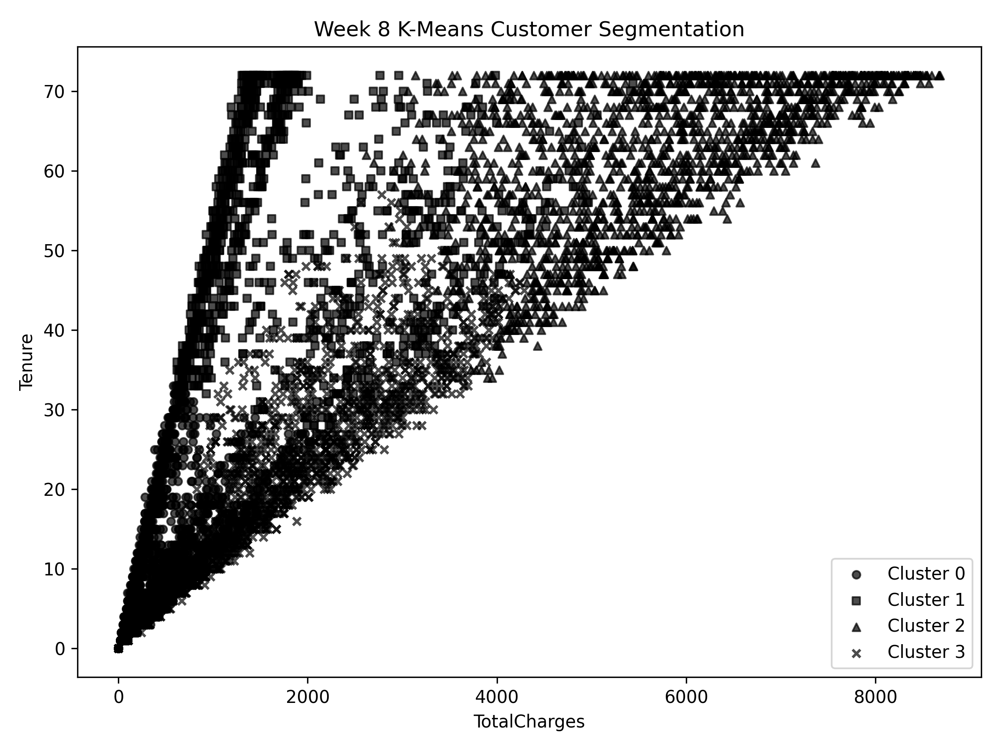
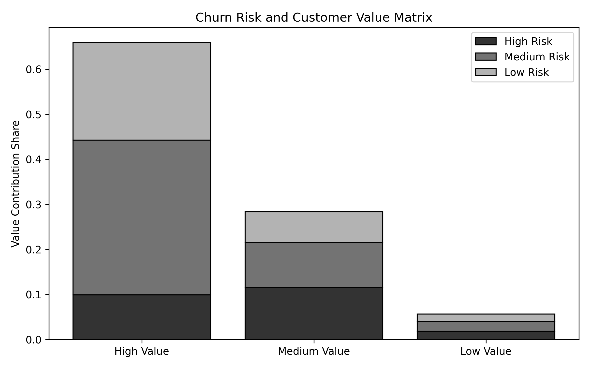
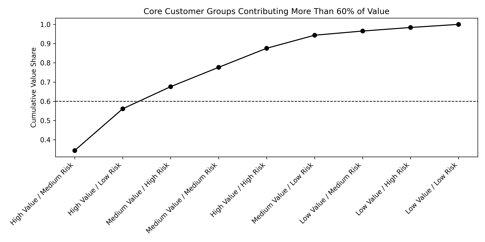

# Week 8 Customer Segmentation and Value Analysis

## Purpose

This stage combines the Week 7 churn risk scores with customer behavior and accumulated spending. The aim is to identify groups that may deserve different retention and relationship-management approaches.

The dataset has no costs, margins, or profit records. TotalCharges is used as a measure of accumulated spending, not observed profit or projected lifetime value. All contribution percentages in this report refer to TotalCharges.

## Tasks and data

The work builds RFM-inspired features, compares K-Means and DBSCAN, creates a customer value/risk matrix, and finds customer groups that collectively account for at least 60% of accumulated charges.

The raw-schema Telco customer records are joined to the supplied Week 7 scorecard using customer_index. That index depends on the original row order. The final implementation checks unique indices, customer coverage, and actual churn alignment before merging. The Telco working snapshot reproduces the source fields needed for this stage without requiring another download.

## RFM-inspired features and value score

| Component | Variable | Meaning and limitation |
| --- | --- | --- |
| Relationship length | tenure | Months with the service; not recency of the last transaction. |
| Usage breadth | service_count | Count of subscribed add-ons; not transaction frequency. |
| Monetary spending | TotalCharges | Accumulated charges; not profit. |
| Churn risk | Week 7 churn_probability and risk_level | Model-generated risk, not a new observed churn outcome. |

The seven services counted are multiple lines, online security, online backup, device protection, technical support, streaming TV, and streaming movies. Their count is the same service-adoption concept used in the earlier feature engineering.

Each of TotalCharges, tenure, and service_count is converted to a percentile rank. The customer value score is:

customer_value_score = 100 * (0.50 * monetary_score + 0.30 * tenure_score + 0.20 * service_score)

The weights prioritize accumulated spending, followed by relationship length and service breadth. They are project choices rather than weights estimated from future profit or retention outcomes. Spending and tenure are related, so this score can emphasize relationship length through more than one component.

| Value level | Score range |
| --- | --- |
| Low Value | Score <= 40 |
| Medium Value | 40 < score <= 70 |
| High Value | Score > 70 |

The three segmentation features are standardized before clustering. Churn probability is used in later profiling and the value/risk matrix, not as an input to K-Means or DBSCAN.

## Comparing clustering methods

| Method | Setting | Clusters | Noise rate | Silhouette | Davies-Bouldin |
| --- | --- | ---: | ---: | ---: | ---: |
| K-Means | k=3 | 3 | 0.00% | 0.4263 | 0.9602 |
| K-Means | k=4 | 4 | 0.00% | 0.4569 | 0.8223 |
| K-Means | k=5 | 5 | 0.00% | 0.4256 | 0.8305 |
| K-Means | k=6 | 6 | 0.00% | 0.4073 | 0.8987 |
| DBSCAN | eps=0.35; min_samples=25 | 8 | 1.60% | 0.0639 | 2.4942 |
| DBSCAN | eps=0.40; min_samples=25 | 8 | 1.09% | 0.0633 | 2.5224 |
| DBSCAN | eps=0.45; min_samples=25 | 8 | 0.85% | 0.0631 | 2.5389 |
| DBSCAN | eps=0.50; min_samples=25 | 1 | 0.06% | Not defined | Not defined |

K-Means with k=4 has the highest silhouette score among these tested settings and provides useful group profiles. DBSCAN produces weakly separated groups at the smaller eps values and one main cluster at eps=0.50. Its clustering metrics exclude noise rows, so the comparisons do not all evaluate exactly the same customers. A higher silhouette and lower Davies-Bouldin score are preferred, but these measures do not establish business usefulness by themselves.

The CSV comparison also retains the Calinski-Harabasz score. No clustering method is claimed to be universally best beyond the settings tested here.

## Reported K-Means groups

| Cluster | Business description | Customers | Mean tenure | Mean TotalCharges | Observed churn | Charge share |
| --- | --- | ---: | ---: | ---: | ---: | ---: |
| 0 | Early-stage low-value customers | 2,629 | 8.48 | 367.20 | 39.22% | 6.01% |
| 1 | Growing medium-value customers | 1,104 | 52.89 | 1,888.26 | 8.06% | 12.98% |
| 2 | Core high-value stable customers | 1,732 | 61.87 | 5,698.76 | 13.39% | 61.47% |
| 3 | Growing medium-value customers | 1,578 | 25.44 | 1,987.27 | 32.76% | 19.53% |

Cluster 2 contains about 24.59% of customers and accounts for 61.47% of accumulated charges. It has an average tenure of 61.87 months and nearly five subscribed add-ons. Its average model risk score is still about 0.4266, so the descriptive stable label should not be read as a guarantee of low future risk.

Cluster 0 is the largest group by customer count but contributes only 6.01% of accumulated charges. Its shorter tenure, lower service breadth, and observed churn of 39.22% suggest a useful group for investigating onboarding and early adoption.

Clusters 1 and 3 share a broad medium-value label, but their observed churn differs substantially. Their cluster IDs and numerical profiles should be used to distinguish them. Cluster numbers are arbitrary labels and may change across reruns without changing the underlying grouping.

The plot shows TotalCharges and tenure, while the clustering also uses service_count. It is a two-dimensional view of a three-feature clustering.

## Customer value and churn risk matrix

Three value levels crossed with three risk levels produce a 3-by-3 matrix with nine groups. The original task wording mentions four quadrants, but the implemented analysis uses nine cells.

| Value level | Risk level | Customers | Mean model risk | Observed churn | TotalCharges | Charge share |
| --- | --- | ---: | ---: | ---: | ---: | ---: |
| High | High | 308 | 69.07% | 37.34% | 1,590,089.85 | 9.90% |
| High | Medium | 936 | 46.50% | 14.00% | 5,521,318.05 | 34.39% |
| High | Low | 683 | 26.71% | 2.20% | 3,482,178.70 | 21.69% |
| Medium | High | 823 | 70.57% | 50.18% | 1,848,956.35 | 11.52% |
| Medium | Medium | 818 | 46.99% | 16.63% | 1,616,313.40 | 10.07% |
| Medium | Low | 729 | 20.65% | 1.51% | 1,090,999.75 | 6.79% |
| Low | High | 714 | 69.64% | 70.59% | 297,707.20 | 1.85% |
| Low | Medium | 1,254 | 47.11% | 38.76% | 348,914.05 | 2.17% |
| Low | Low | 778 | 26.55% | 7.46% | 259,691.35 | 1.62% |

High-value/high-risk customers are a natural group to review for retention. High-value/low-risk customers may deserve ongoing relationship management. Lower-spending/high-risk customers may call for lower-cost outreach rather than expensive individual offers. Those are proposed management uses, not evaluated campaign results.

## Groups accounting for at least 60% of charges

The nine value/risk cells are sorted by their contribution to TotalCharges. Groups are included until the cumulative contribution first reaches or exceeds 60%.

| Group | Customers | TotalCharges | Charge share | Cumulative share |
| --- | ---: | ---: | ---: | ---: |
| High Value / Medium Risk | 936 | 5,521,318.05 | 34.39% | 34.39% |
| High Value / Low Risk | 683 | 3,482,178.70 | 21.69% | 56.08% |
| Medium Value / High Risk | 823 | 1,848,956.35 | 11.52% | 67.59% |

Together, these three groups contain 2,442 customers and account for about 67.59% of accumulated charges. This is a contribution-based selection of entire matrix cells; it does not show that 67.59% of profit has been identified or that this is an optimal retention budget allocation.

The High Value / High Risk cell is outside this greedy 60% selection but can still be important for retention. Contribution ranking and intervention priority answer different business questions.

## Suggested actions

- High Value / Medium Risk: consider proactive support, renewal reminders, and usage reviews.
- High Value / Low Risk: maintain satisfaction and assess relevant renewal or expansion opportunities.
- High Value / High Risk: review individual service and contract issues alongside the contribution-based core groups.
- Medium Value / High Risk: consider timely, lower-cost follow-up and targeted support.
- Low Value / High Risk: use proportionate, standardized outreach rather than assuming intensive retention is economical.
- Early-stage customers: investigate onboarding and whether useful support, security, or backup services are understood and adopted.

## Limits

This is RFM-inspired analysis, not a conventional transaction-based RFM model. There is no real transaction recency, purchase frequency, cost, or profit information. Cluster validation is internal to the same customer sample. Risk scores cover the full dataset, including training customers, and inherit the original model's preprocessing and evaluation limits.

The dataset also lacks many business-to-business cloud variables, such as company size, industry, geography, resource usage histories, and contractual economics. The segmentation therefore describes this Telco proxy dataset and should not be presented as a validated Azure customer segmentation.
